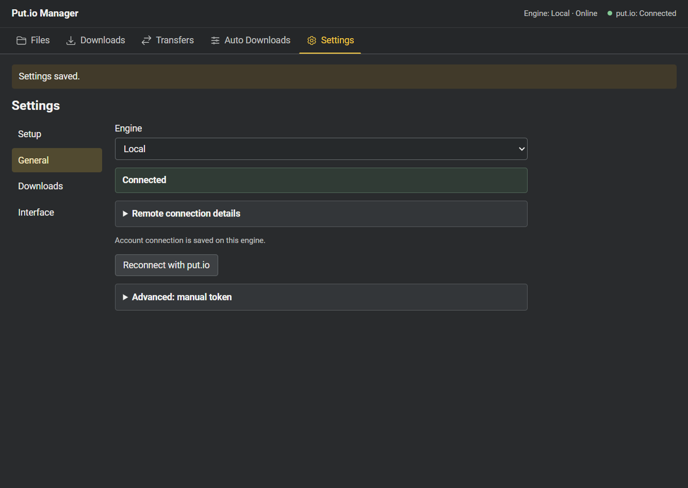
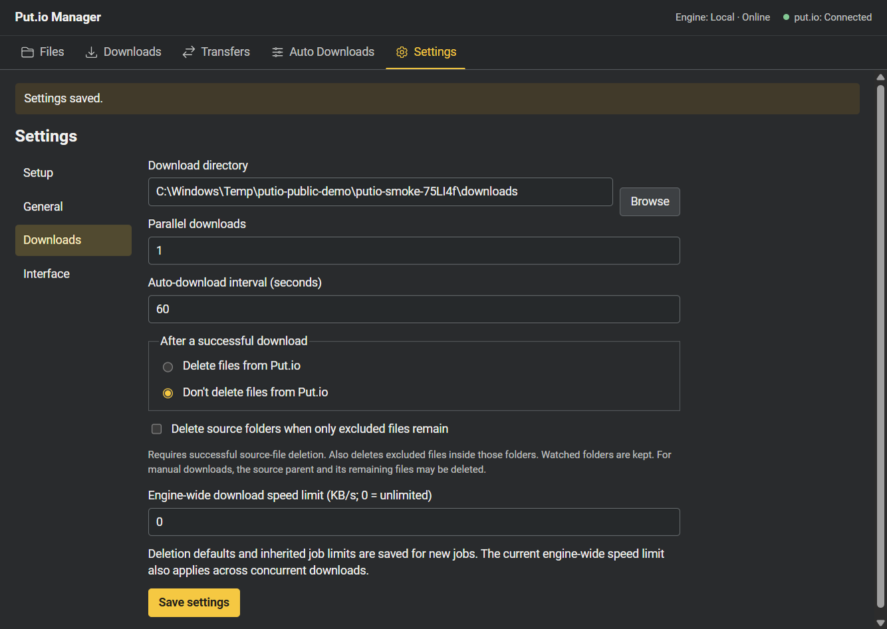
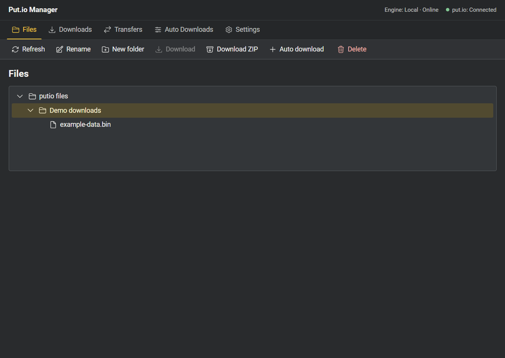
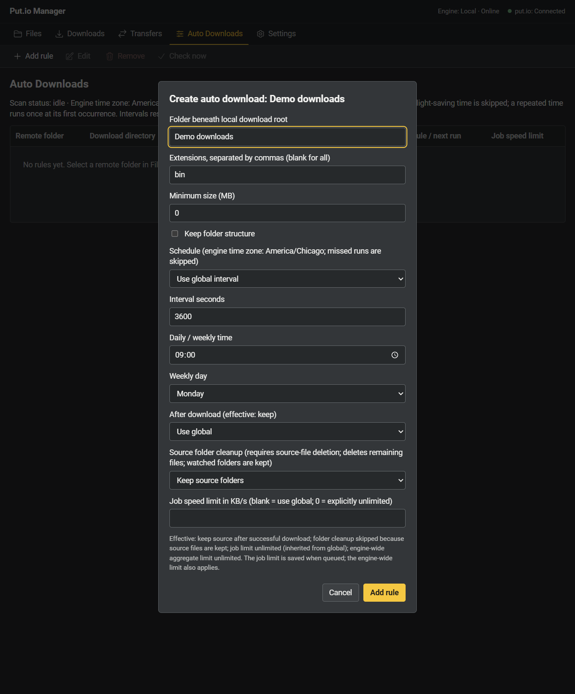
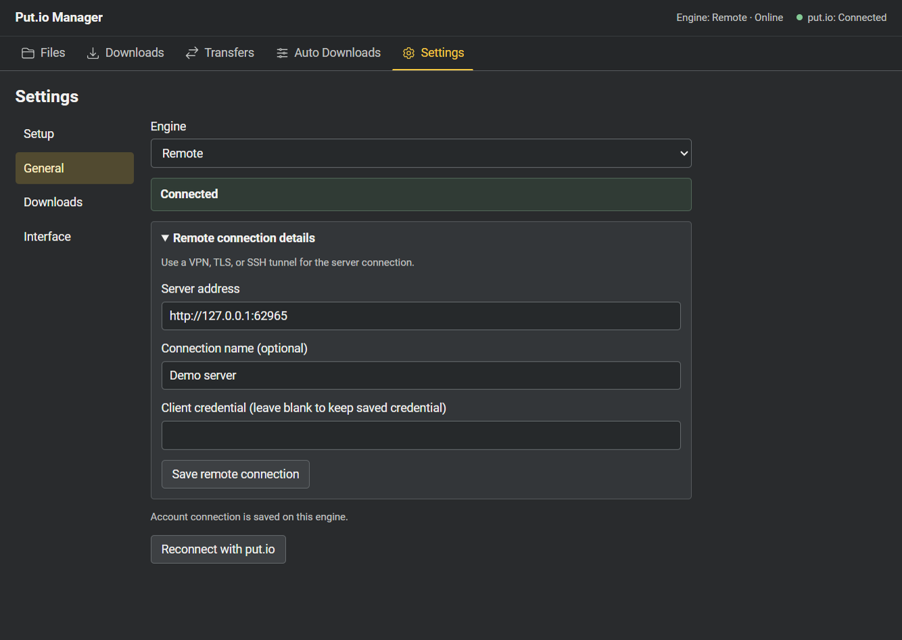

# Putio Manager

Browse your put.io account, copy files to your computer or a Linux download server, and automate repeated downloads from selected folders.

The desktop app runs on Windows, macOS and Linux. A separate headless engine can keep downloading on a server after the desktop app closes. Optional source cleanup runs after a download has been saved successfully.

**Start here:** [Download](#download) · [Screenshot guide](#screenshot-guide) · [Desktop setup](#desktop-setup) · [Linux remote server](#linux-remote-server) · [Everyday use](#everyday-use) · [Jellyfin](#connect-a-jellyfin-library) · [Troubleshooting](#troubleshooting)

## Download

Choose your operating system and processor. Each archive contains the desktop app, the headless engine, a matching Node runtime and a launcher. No separate Node installation is needed to run these downloads.

| Platform | Most Intel / AMD computers | ARM computers |
| --- | --- | --- |
| Windows | [Windows x64 ZIP](https://github.com/garbledhamster/putio-manager/releases/download/v2.0.1/PutioManager-2.0.1-windows-x64.zip) | [Windows ARM64 ZIP](https://github.com/garbledhamster/putio-manager/releases/download/v2.0.1/PutioManager-2.0.1-windows-arm64.zip) |
| macOS | [Intel Mac archive](https://github.com/garbledhamster/putio-manager/releases/download/v2.0.1/PutioManager-2.0.1-macos-x64.tar.gz) | [Apple silicon archive](https://github.com/garbledhamster/putio-manager/releases/download/v2.0.1/PutioManager-2.0.1-macos-arm64.tar.gz) |
| Linux | [Linux x64 archive](https://github.com/garbledhamster/putio-manager/releases/download/v2.0.1/PutioManager-2.0.1-linux-x64.tar.gz) | [Linux ARM64 archive](https://github.com/garbledhamster/putio-manager/releases/download/v2.0.1/PutioManager-2.0.1-linux-arm64.tar.gz) |

[Release notes and all files](https://github.com/garbledhamster/putio-manager/releases/tag/v2.0.1) · [SHA-256 checksums](https://github.com/garbledhamster/putio-manager/releases/download/v2.0.1/SHA256SUMS.txt)

These are **unsigned portable distributions**, not signed installers. The operating system may block an unsigned app. Follow your organization's policy; do not disable security software to run it. macOS signing and notarization and Windows code signing are not included. The release's CI results describe which native builds and isolated checks passed; they do not establish playback or compatibility with every computer.

To find your processor: Windows **Settings → System → About → System type**; macOS **Apple menu → About This Mac**; Linux `uname -m` (`x86_64` means x64, `aarch64` means ARM64). Linux desktop mode also needs the usual Electron desktop libraries and a graphical session. Linux server mode does not need Electron or a display.

<details>
<summary>Verify a downloaded archive</summary>

Download `SHA256SUMS.txt` from the same release. In PowerShell:

```powershell
Get-FileHash .\PutioManager-2.0.1-windows-x64.zip -Algorithm SHA256
```

On macOS:

```sh
shasum -a 256 PutioManager-2.0.1-macos-arm64.tar.gz
```

On Linux, with the checksums and archive in the same directory:

```sh
sha256sum --check --ignore-missing SHA256SUMS.txt
```

Compare the entire hash for the exact filename. A mismatch means you should obtain a fresh copy before extracting it. Checksums detect a mismatched file; they are not a code-signing identity.

</details>

## Screenshot guide

Every image below comes from the real app running against a newly generated, isolated demonstration service. Folder names, files, transfers, credentials and destinations are synthetic. `C:\Windows\Temp\putio-public-demo` is a disposable demonstration location; choose your own download destination. No live account, household server or media library appears in these images. Click an image to enlarge it; use the numbered links to follow the full instructions.

<table>
  <tr>
    <td width="50%"><a href="docs/images/01-setup.png"></a><br><b>1. Choose where downloads run.</b> <a href="#desktop-setup">Desktop setup</a></td>
    <td width="50%"><a href="docs/images/02-connect-account.png"></a><br><b>2. Connect put.io.</b> <a href="#link-your-account-and-choose-a-destination">Account and destination</a></td>
  </tr>
  <tr>
    <td><a href="docs/images/03-download-settings.png"></a><br><b>3. Keep sources for your first copy.</b> <a href="#make-your-first-download">First download</a></td>
    <td><a href="docs/images/04-browse-files.png"></a><br><b>4. Browse and select a file.</b> <a href="#browse-and-manage-putio-files">Files</a></td>
  </tr>
  <tr>
    <td><a href="docs/images/05-automatic-rule.png"></a><br><b>5. Automate a selected folder.</b> <a href="#automatic-download-rules">Rules and schedules</a></td>
    <td><a href="docs/images/06-download-progress.png"></a><br><b>6. Check completed and canceled jobs.</b> <a href="#understand-download-status">Status and recovery</a></td>
  </tr>
  <tr>
    <td><a href="docs/images/07-remote-connection.png"></a><br><b>7. Connect to your Linux engine.</b> <a href="#connect-the-desktop-through-ssh">SSH and Remote setup</a></td>
    <td><a href="docs/images/08-remote-download-root.png"></a><br><b>8. Select the server destination.</b> <a href="#connect-the-desktop-through-ssh">Remote download root</a></td>
  </tr>
</table>

## Understand Local and Remote

| Operation | What happens |
| --- | --- |
| **Transfer** | put.io fetches a source into your put.io account. |
| **Download, Local engine** | This computer copies a file from put.io to the local destination you choose. |
| **Download, Remote engine** | Your server copies a file from put.io to an allowed server destination. The file stays on that server. |
| **Automatic-download rule** | The selected engine periodically checks a put.io folder and queues matching files. |
| **Optional cleanup** | The selected engine deletes the put.io source after successful download finalization, subject to the job's saved options. |

The **Engine** and **put.io** indicators show separate connections. A reachable Remote engine can still need account authorization. Selecting Remote does not copy existing local jobs or account settings to the server. A connection failure does not silently switch downloads back to Local.

## Desktop setup

### Windows

1. Download the ZIP for your processor and extract the **entire archive** to a folder you intend to keep. Do not launch from inside the ZIP.
2. Open the extracted `PutioManager-win32-x64-distribution` folder (or its ARM64 equivalent).
3. Double-click `launch.cmd`. For an explicit desktop launch from PowerShell in that folder:

   ```powershell
   .\launch.cmd --mode gui
   ```

4. Keep the `desktop` folder, `node.exe`, `launch.cjs` and other distribution files together. Make a shortcut to `launch.cmd` if desired.
5. Continue with [account and destination](#link-your-account-and-choose-a-destination).

### macOS

1. Download the Apple silicon or Intel archive and extract it. Keep the whole extracted distribution together in a permanent location.
2. Open `desktop/PutioManager.app`, or open Terminal in the distribution folder and run:

   ```sh
   ./launch --mode gui
   ```

3. If macOS blocks the unsigned application, use the normal policy-approved app-opening process described by [Apple's guidance for opening apps safely](https://support.apple.com/en-us/102445). Do not disable Gatekeeper or remove security attributes as a setup step.
4. Continue below. The server setup later in this guide is optional; Local mode works on the Mac itself.

### Linux desktop

1. Extract the correct archive in a permanent directory on your desktop machine.
2. In a graphical session, run `./launch --mode gui` from that directory. If launching reports a missing shared library, install the Electron runtime dependencies appropriate to your distribution through its package manager.
3. Run as your ordinary user. Do not use root or `--no-sandbox` to work around a desktop launch error.
4. Continue below. For a server without a display, use [Linux remote server](#linux-remote-server).

### Link your account and choose a destination

1. Open **Settings → General** and choose **Local** for downloads on this computer. For a prepared server, use [Remote connection steps](#connect-the-desktop-through-ssh) instead.
2. Click **Connect with put.io**. Sign in to put.io in the browser and approve the connection. Return to the app and wait for the put.io indicator to show **Connected**.
3. Account authorization belongs to the selected engine. Reconnect with the same control if authorization expires. The app uses operating-system secure storage when available; if the screen says the connection lasts only until the engine stops, reconnect after restarting or configure a supported secure-storage backend.
4. Open **Settings → Downloads**. In Local mode click **Browse**, choose an existing destination, and click **Save settings**. In Remote mode select an allowed **Download root** and click **Use root**.
5. For the first download, select **Don't delete files from Put.io**. Leave **Delete source folders when only excluded files remain** unchecked. Save settings.
6. **Settings → Setup** links back to the account and destination controls whenever you need to revisit them.

The optional manual-token disclosure is an advanced alternative to browser linking. Enter only a token you obtained for your own account. Never paste a token into an issue, screenshot, command argument or shared log.

### Make your first download

1. Use a small file you own or have permission to download. Keep source deletion off while proving your setup.
2. Open **Files**, click **Refresh**, expand a folder and select the file. Click **Download**.
3. Review the download dialog's source-deletion, folder-cleanup and speed options. Choose **Don't delete files from Put.io** and **Keep source folders** if overriding defaults. Read the **Effective** summary, then submit.
4. Open **Downloads**. Wait for the job to finish successfully. A zero-byte queue entry, an active progress bar or a transfer finishing at put.io does not establish a completed local copy.
5. Confirm the copy is accessible at the chosen destination on the selected engine host. If using Jellyfin, also complete the [library check](#connect-a-jellyfin-library).
6. Refresh **Files** and confirm the put.io source is still present. Once the complete path works, decide whether [optional source cleanup](#optional-source-cleanup) fits your workflow.

## Linux remote server

This example uses a new Debian/Ubuntu-style systemd service, a dedicated `putio` service user, `/srv/putio-downloads` for downloads and `/var/lib/putio-manager/private` for private configuration. These names and `downloads.example.net` are fictional examples. Replace the SSH hostname and operator account with your own. Use a new installation directory; these commands do not migrate an existing engine.

The server needs outbound HTTPS to put.io, sufficient disk space, a supported Linux CPU/runtime, systemd for the service example, and an already configured SSH server reachable by your desktop. The desktop can run Windows, macOS or Linux. The headless engine uses the bundled Node runtime and does not need Electron, a desktop session or an npm install.

### 1. Install the server distribution

Download the matching **Linux** archive and `SHA256SUMS.txt` from the release. Verify its hash, then extract the archive on the server. For x64:

```sh
tar -xzf PutioManager-2.0.1-linux-x64.tar.gz
sudo install -d -m 0755 /opt/putio-manager
sudo mv PutioManager-linux-x64-distribution /opt/putio-manager/2.0.1
sudo chown -R root:root /opt/putio-manager/2.0.1
```

For ARM64 use the ARM64 archive and extracted folder name. `/opt/putio-manager/2.0.1` must be unused before this move. Keeping program files root-owned prevents the download service from rewriting its executable.

Create the service identity and writable data locations once:

```sh
sudo useradd --system --user-group --home-dir /var/lib/putio-manager --create-home --shell /usr/sbin/nologin putio
sudo install -d -o putio -g putio -m 0750 /var/lib/putio-manager /srv/putio-downloads
```

If the account already exists, inspect it and reuse it only if it is the intended dedicated service identity. If downloads belong on an external disk, mount that disk persistently first and use its real mounted destination. Verify the mount and permissions before starting the engine; an ordinary empty mountpoint is not proof the disk is attached. Do not recursively change ownership of an existing media library as a shortcut.

### 2. Create a new private configuration

Run this in an **interactive server terminal**:

```sh
sudo -u putio /opt/putio-manager/2.0.1/launch --mode headless setup --config /var/lib/putio-manager/private/config.json
```

At the prompts enter:

```text
Existing absolute download directory: /srv/putio-downloads
Loopback port [5173]: 5173
```

The root directory must already exist. The parent `private` directory must **not** exist: setup creates it privately and refuses to overwrite an existing installation. Do not create `private` with an earlier `mkdir` step and do not rerun setup over a working configuration.

Setup creates `config.json`, a `client-token`, a separate `credential-key` and a state path. The client token authorizes desktop control of this server; the encryption key protects saved put.io authorization. Both are secrets. POSIX key files must remain owned by the service identity and inaccessible to other users. The configuration binds to **127.0.0.1**, not a public interface.

### 3. Install the unprivileged systemd service

Create `/etc/systemd/system/putio-manager.service` with your editor:

```ini
[Unit]
Description=Putio Manager download engine
Wants=network-online.target
After=network-online.target
RequiresMountsFor=/srv/putio-downloads /var/lib/putio-manager

[Service]
Type=simple
User=putio
Group=putio
WorkingDirectory=/opt/putio-manager/2.0.1
ExecStart=/opt/putio-manager/2.0.1/node /opt/putio-manager/2.0.1/headless/server/cli.js serve --config /var/lib/putio-manager/private/config.json
Restart=on-failure
RestartSec=5
TimeoutStopSec=60
UMask=0077
NoNewPrivileges=true
PrivateTmp=true
ProtectHome=true
ProtectSystem=strict
ReadWritePaths=/var/lib/putio-manager /srv/putio-downloads

[Install]
WantedBy=multi-user.target
```

If you choose different roots, update the configuration, `RequiresMountsFor` and `ReadWritePaths` together. This example limits the service's writable locations to its own data and download roots. It does not replace Linux ownership, disk-mount checks, a firewall or SSH authentication. The service directives are documented in [systemd.service](https://www.freedesktop.org/software/systemd/man/latest/systemd.service.html) and [systemd.exec](https://www.freedesktop.org/software/systemd/man/latest/systemd.exec.html).

Start and inspect the service:

```sh
sudo systemctl daemon-reload
sudo systemctl enable --now putio-manager.service
sudo systemctl status putio-manager.service --no-pager
sudo journalctl -u putio-manager.service -n 30 --no-pager
```

Look for **Server ready** in the service log. Check its authenticated status locally:

```sh
sudo -u putio /opt/putio-manager/2.0.1/launch --mode headless status --config /var/lib/putio-manager/private/config.json
```

Status can include private filenames and paths. Inspect it locally; do not post the complete output publicly. An active systemd process alone does not prove the account is connected or a download finished.

### 4. Authorize put.io on the server

With the service running, use another interactive server terminal:

```sh
sudo -u putio /opt/putio-manager/2.0.1/launch --mode headless auth --config /var/lib/putio-manager/private/config.json
```

Open the displayed **put.io** authorization link in your browser and approve the connection. That link is temporary and private; do not capture it in documentation or logs. Then check status again. You can also connect the desktop to the Remote engine and use **Connect with put.io** there; the account is still saved on the server.

### Connect the desktop through SSH

1. Use your ordinary SSH operator account, separate from the `putio` service user. Verify the server's SSH host key through a trusted channel on first connection. Do not turn off host-key checking.
2. In **PowerShell on Windows** or **Terminal on macOS/Linux**, start this tunnel and leave its window open:

   ```sh
   ssh -N -T -o ExitOnForwardFailure=yes -o ServerAliveInterval=30 -o ServerAliveCountMax=3 -L 127.0.0.1:15173:127.0.0.1:5173 operator@downloads.example.net
   ```

   Replace only the example account/hostname and any deliberately changed ports. The first `127.0.0.1:15173` is your desktop listener; the final `127.0.0.1:5173` is the server's loopback engine. No router port-forward or public engine listener is needed. Windows needs the [OpenSSH Client](https://learn.microsoft.com/en-us/windows-server/administration/openssh/openssh_install_firstuse), not an SSH server on the desktop. A successful `-N` tunnel normally stays quiet.
3. In a private server terminal, retrieve the **client** credential once:

   ```sh
   sudo -u putio cat /var/lib/putio-manager/private/client-token
   ```

   This command deliberately displays a secret. Use your own trusted terminal; never record, screenshot or paste its output into chat/issues. Copy it directly into the app's masked client-credential field. Do not copy `credential-key`, which is not a desktop connection token. Clear your clipboard after pasting and close the private terminal when finished.
4. In the desktop app open **Settings → General → Remote connection details**. Enter server address **`http://127.0.0.1:15173`**, an optional friendly name such as **My download server**, and that client credential. Click **Save remote connection**.
5. Choose **Engine → Remote**. Wait for **Remote · Online** and the put.io connected indicator. If you have not linked put.io, click **Connect with put.io** and approve it in the browser.
6. Open **Settings → Downloads**, choose **Download root → Downloads**, and click **Use root**. Read the **Remote server download directory** path: it belongs to the server, not the desktop. Keep source deletion off and save settings for the first copy.
7. Run [the first-download check](#make-your-first-download). Close the desktop only after you understand that the **server service continues its queued and scheduled work**. Closing the SSH tunnel disconnects the desktop; it does not stop the server's engine.

Keep both desktop and server on compatible **Remote protocol version 2** software. An older engine is rejected before commands are sent. If port `15173` is already used on the desktop, choose another unused local port and change the desktop server address to match. The server port remains `5173` unless you changed its configuration.

For routine stopping, use **Downloads → Pause** first and let active copies finish. To stop the service completely:

```sh
sudo systemctl stop putio-manager.service
```

To resume the service, use `sudo systemctl start putio-manager.service`, then resume queued work in the app if it is paused. The CLI also supports `pause` and `resume` in place of `status` with the same config argument. Pause survives an engine restart.

## Everyday use

### Browse and manage put.io files

**Files** shows your account's folder tree. Click **Refresh** to reload it, expand folders and select an item before choosing an action. **New folder**, **Rename** and **Delete** change your put.io account. Use the displayed confirmation and verify the selected item; manual Delete is separate from after-download cleanup.

**Download** copies a selected file to the executing engine's download destination. **ZIP** downloads the selected file or folder as a ZIP archive. ZIP preparation can take time at put.io; a ZIP response reporting missing files is rejected. The manager saves the ZIP; it does not extract and organize it into a media library.

The **Open folder** action opens a Local destination on this computer. A Remote server directory cannot be opened as though it were a desktop path; use your own authorized server access or library application to view it.

### Understand download status

**Downloads** lists jobs and progress. Select a job for **Cancel** or, when offered, **Retry**.

| Control or result | Meaning and next action |
| --- | --- |
| **Pause** | Prevents new rule scans and job starts; active copies finish. Use Cancel separately to stop a selected copy. |
| **Resume** | Allows queued jobs and rule scans to start again. |
| **Cancel / Cancel all** | Stops selected or outstanding downloads. It does not remove your put.io source as a successful-download cleanup. |
| **Retry** | Explicitly retries an eligible failed, canceled or interrupted job. Inspect its error and destination first. |
| **Completed** | The local destination was finalized. Read any accompanying cleanup warning separately. |
| **Interrupted** | A copy was active when the engine restarted. Check the error and explicitly Retry when ready. |
| **Downloaded locally; remote cleanup failed / outcome unknown** | Keep the good downloaded copy. Refresh put.io and inspect the specific source before deciding what cleanup to perform. Do not assume deletion succeeded or blindly repeat it. |

Existing destination files are protected from silent overwrite. Changing defaults affects new jobs; already queued jobs retain their saved per-job options. Download URLs are refreshed when needed rather than stored as permanent credentials.

### Transfers into put.io

1. In **Files**, select the put.io destination folder.
2. Open **Transfers** and choose **Add transfer**.
3. Paste a supported source link you are authorized to use, review its destination, and submit.
4. Refresh **Transfers** to follow put.io's progress. Cancel a selected transfer when needed.

A finished transfer means the source reached put.io. Use a manual download or an automatic rule to copy it from put.io to your computer/server. Incoming magnet-link handling can be registered in **Settings → Interface** where supported; incoming links use your currently selected engine. Registration is optional.

### Automatic-download rules

1. Set the correct engine and download root first. In **Files**, select a put.io **folder** and click **Auto download**. You can also open **Auto Downloads** and add a rule for the selected folder.
2. Review the destination prefilled from the folder name. The rule destination is created within the selected engine's allowed root. Use a contained subfolder such as `Demo downloads`; avoid pointing several unrelated rules at the same destination.
3. Enter comma-separated extensions, for example `pdf, txt`, or leave blank for all file extensions. Matching is case-insensitive. **Minimum size (MB)** is the lower size threshold; use `0` to include small files. The calculation uses 1,048,576 bytes per displayed MB.
4. Choose **Keep folder structure** if nested source folders should remain nested in the destination.
5. Choose a schedule: **Use global interval**, the rule's own **Interval**, **Daily**, or **Weekly**. Daily/weekly time uses the **engine time zone shown in the dialog**, which may differ from your desktop in Remote mode. Missed scheduled runs are skipped rather than accumulated.
6. Review deletion, source-folder cleanup and speed overrides and the **Effective** summary. Keep source deletion off for a new rule until you have verified its matches and destination. Save the rule.
7. Use **Check now** in **Auto Downloads** to run a rule check when the engine is connected and resumed. Check **Downloads** for actual work. Rule-list presence alone does not prove a successful download.
8. Select a rule to **Edit** or **Remove** it. Removing a rule stops future scans for that rule; check existing queued jobs separately. Inspect the displayed next run after editing a schedule.

The engine avoids duplicate active work for the same source/destination. Keep history and state with the engine rather than deleting them to try to force a re-download.

### Speed, parallelism and per-job choices

**Settings → Downloads** controls the maximum concurrent downloads, global automatic-download interval, default source handling and **Engine-wide download speed limit (KB/s; 0 = unlimited)**.

Rules and file/ZIP download dialogs can **Use global** or override the source-file and folder-cleanup choices. A blank job/rule speed limit inherits the global default; `0` is an explicit unlimited job limit. The engine-wide aggregate speed limit still caps concurrent traffic. Review the **Effective** summary to see the actual inherited choices before queuing.

Default deletion and inherited job limits are captured when a job is queued. Later changes to those defaults do not rewrite existing jobs. The current engine-wide aggregate cap also applies to active traffic.

### Optional source cleanup

Enable cleanup only after a successful copy has reached the right destination and, when relevant, your library can read it.

1. In **Settings → Downloads**, choose **Delete files from Put.io** to make successful source-file cleanup the default, or set deletion for an individual rule/download instead. Click **Save settings**.
2. For a specific rule or manual file/ZIP download, choose **Use global**, **Delete**, or **Keep**. Read the effective summary. Keep overrides deletion for that job.
3. A source is eligible for deletion only after the destination has been successfully finalized. A completed download with a cleanup error remains a completed local copy with a separate warning.
4. Refresh **Files** to confirm the intended source disappeared. Verify the destination remains usable. If provider cleanup failed or is uncertain, inspect before taking a separate action.

**Source-folder cleanup is a different, broader option.** **Delete source folders when only excluded files remain** is off by default. After successful source-file deletion, it can delete the source folder **and excluded leftovers inside it**, such as files rejected by a rule's extension/size filters. Watched folders are kept; explicit Keep choices, pending/failed work and uncertain state can defer cleanup. For manual downloads the source parent and remaining files may be affected. Turn it on only when you intend that broader scope; a rule or job can explicitly keep source folders.

For a ZIP, source cleanup applies to the **selected put.io source**, not merely a temporary ZIP download URL. Put.io listing and deletion are separate operations, so concurrent changes by other clients can affect what is present at cleanup time. Avoid organizing the same source folder elsewhere during its cleanup.

### Interface and startup

**Settings → Interface** controls tooltips, supported desktop login startup and optional magnet registration. Save changed settings. Desktop login startup is supported through native Windows/macOS controls; Linux desktop login startup is explicitly unsupported. Linux headless reboot startup comes from the systemd service, not this desktop checkbox. Tray behavior depends on the desktop environment.

Local downloads and scans belong to the desktop process, so keep that engine running. Remote work belongs to the server service and continues after its desktop client closes. Use Pause/Cancel or stop the service when you intend to stop work.

## Connect a Jellyfin library

Putio Manager saves files; Jellyfin indexes a directory you configure. It does not receive a file directly from the desktop client. Use the same underlying directory on the engine host and the Jellyfin host/container mapping.

For example, an operator might use:

| Layer | Fictional example |
| --- | --- |
| Manager server download root | `/srv/putio-downloads` |
| Rule destination under that root | `Movies` |
| Resulting host directory | `/srv/putio-downloads/Movies` |
| Docker bind, if Jellyfin is containerized | `/srv/putio-downloads/Movies:/media/Movies:ro` |
| Jellyfin library folder inside that container | `/media/Movies` |

Use your existing Jellyfin deployment's supported volume/library controls; adapt paths without replacing unrelated libraries. The Manager service needs write permission on its destination. Jellyfin needs read/traverse permission through its normal account/group or ACL; avoid world-writable permissions or recursive ownership changes to an existing library.

1. Keep source deletion disabled for the first library test.
2. Configure a rule or destination on the correct engine host that maps to the intended Jellyfin library. If using a file/ZIP manual download, remember it uses the engine's current destination, and ZIPs are not automatically extracted.
3. Download a small media item you are authorized to use and wait for successful completion in **Downloads**.
4. In Jellyfin's dashboard, confirm the library points to the corresponding host/container path and run its supported library scan.
5. Confirm the new item appears and can be read/played in Jellyfin. A scan starting, a Manager Completed status or a library folder name alone does not prove this end-to-end result.
6. Only then enable the cleanup policy you want. For the next completed item, check both Jellyfin availability and the specific source's disappearance from put.io.

For deployment-specific library details, consult [Jellyfin's library documentation](https://jellyfin.org/docs/general/server/libraries/). If Manager and Jellyfin run on different machines, arrange your own authenticated storage share/mount; setting a desktop-looking path in the app does not transfer the download to another host automatically.

## Update, back up and recover

### Desktop update

1. Pause the selected engine and let active copies finish. For Local mode, quit the app completely before replacing program files. A Remote server keeps its own lifecycle.
2. Download and verify the new archive. Extract it to a **new** version folder rather than merging files into the old bundle.
3. Keep the old bundle until the new one opens correctly. Point shortcuts at the new launcher, start it, check the selected engine/account/destination, then Resume if appropriate.
4. Update a Remote server to a matching protocol version before using a newer client that requires it. Account state and history are separate from portable program files; do not copy your private profile into a release archive or public issue.

### Linux server backup and upgrade

1. Pause work, wait for active jobs to finish and stop `putio-manager.service`. Confirm it is stopped. Do not run two engines against the same state directory.
2. Back up the **whole private configuration directory and state together**, including `client-token` and `credential-key`, to protected storage. The encryption key is required to use encrypted saved authorization. Back up your downloaded files separately if you need them; the application state backup is not a media backup.
3. For the example layout, this creates a private local archive without printing secrets:

   ```sh
   sudo install -d -m 0700 /var/backups/putio-manager
   sudo sh -c 'umask 077; tar -czf /var/backups/putio-manager/private-backup.tgz -C /var/lib putio-manager'
   ```

   Choose a new backup filename if one already exists. Keep it private and verify you can read its archive listing locally. Never attach it to GitHub.
4. Extract the verified new distribution into a new root-owned version directory. Update the service's `WorkingDirectory` and both executable paths in `ExecStart`. Keep the config/state paths unchanged; **do not rerun setup** over an existing configuration.
5. Run `sudo systemctl daemon-reload`, start the service, and check its status locally. Reopen the tunnel and desktop; verify the selected Remote engine, account, destination and existing history before resuming.
6. If rollback is necessary, stop the new service first. Preserve its state, restore the matching earlier program/service paths and a compatible protected state backup if needed, then verify before resuming. Never let old and new engines share the same state concurrently.

### After interruption or an error

Queued durable jobs can obtain fresh source URLs. A job interrupted while downloading/finalizing is marked **Interrupted** and requires **Retry**. An uncertain cloud cleanup is not automatically replayed. Inspect the job message, destination and source before retrying or cleaning up.

Only one process can own an engine state directory. If startup reports an ownership/recovery problem, confirm no engine/service is still using it. Do not delete ownership locks or recovery guards automatically. Keep a protected backup and obtain help with a minimal sanitized error description.

## Troubleshooting

| Symptom | Check and next action |
| --- | --- |
| **Remote unavailable / reconnecting** | Confirm the server service is ready, the SSH tunnel is still open, the desktop URL uses the tunnel's local port, and client/server protocol versions match. Restore the connection; do not switch to Local unless you intend downloads on this computer. |
| **Remote authentication rejected** | Use the server's `client-token`, not its encryption key or put.io token. Save it in Remote connection details. Keep the value out of support reports. |
| **put.io not connected** | Link the account on the selected engine. Browser authorization does not transfer a Local connection to Remote automatically. |
| **Setup failed** | Use an absolute config path whose parent is new, an existing absolute download root, a valid free port and the intended service user's permissions. Do not delete working state just to rerun setup. |
| **No remote download roots** | Check the server config's allowed roots and service filesystem permissions. Restart the service after a deliberate config edit, then select **Use root**. |
| **No rule matches / nothing starts** | Check engine/account status, pause state, selected source folder, extension/minimum-size filters, schedule/time zone and destination. Use **Check now** in Auto Downloads when resumed and inspect job errors. |
| **Destination unavailable / permission error** | Check the actual engine host, mounted disk, free space and dedicated identity's write/traverse rights. For systemd, check `ReadWritePaths` too. Do not broadly relax permissions. |
| **Completed but still on put.io** | Inspect the job's saved Keep/Delete choice and any cleanup warning. Changing a default later does not change that already queued job. |
| **Completed but absent from Jellyfin** | Check the real host/container mapping, library type, Jellyfin read permissions and library scan. The Manager may have saved a ZIP, which it does not extract. |
| **Interrupted after restart** | Check the job message and destination, then explicitly **Retry** if appropriate. Do not remove history or state to force recovery. |
| **Linux desktop sandbox/runtime error** | Use your distribution's supported Electron prerequisites and sandbox configuration as an ordinary user; do not launch the GUI as root or add `--no-sandbox`. Headless mode uses the bundled Node runtime. |
| **Unsigned app blocked** | Review the source/release provenance and your operating-system/organization policy. Do not disable protections as a workaround. |

For help, open an [issue](https://github.com/garbledhamster/putio-manager/issues) with the app version, OS/architecture, Local or Remote mode, exact sanitized error and the steps to reproduce with generated examples. Remove account identifiers, tokens, authorization links, real filenames, private paths, hostnames/IPs and logs containing them. A tiny fictional example is more useful than a full private configuration or state archive.

## Development and license

The application uses TypeScript and Electron with plain core services and a narrow desktop bridge. The renderer has no Node access. Remote mode uses authenticated commands and state subscriptions; browser-origin API requests are rejected. The server normally listens on loopback behind your authenticated tunnel. Local credentials use supported OS secure storage; headless credentials use an independently protected key.

Use the Node version specified by the project's build configuration, then:

```sh
npm ci
npm run verify
npm run package
npm run test:package
npm run package:distribution
```

`verify` checks type/build, disposable service/integration fixtures and the actual Electron renderer scenario. `test:package` runs the same isolated scenario through the native package. Package each platform/architecture on its matching native runner. These tests use generated data and do not need a real put.io account. Screenshot generation uses the same synthetic fixture with `--smoke-test --evidence-dir=ABSOLUTE_OUTPUT_DIRECTORY`; use a generic isolated temporary root so private usernames never enter screenshots.

Putio Manager is licensed under **GPL-3.0-only**; see [LICENSE](LICENSE). It builds on the original put.io Download Manager by **Gunhan Ozden**. Bundled Heroicons use the MIT license; their notices and asset provenance are retained. Distributions include the applicable application, Electron/Chromium and Node notices. This is an independent application, not an official put.io or Jellyfin product.
