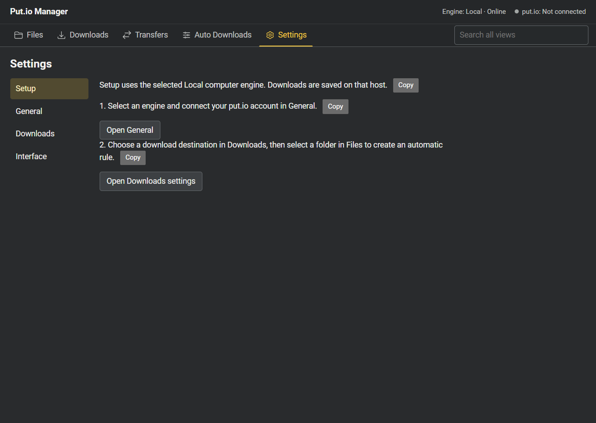
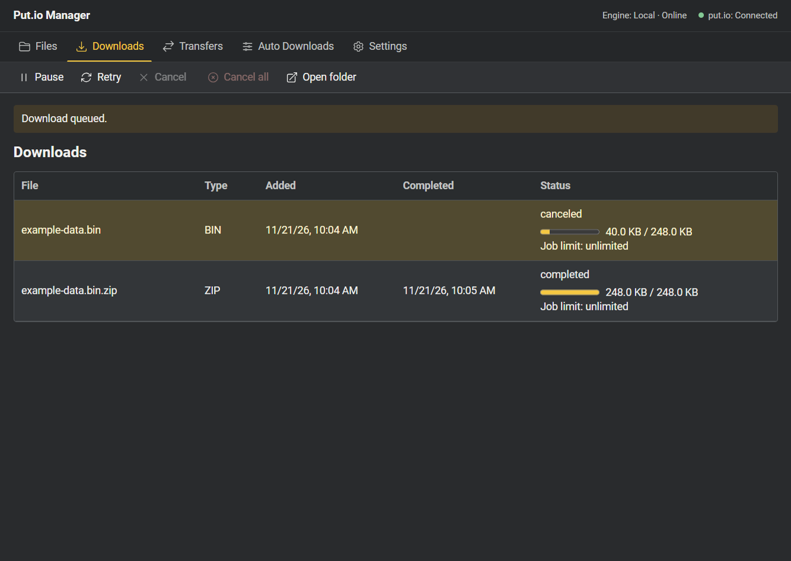
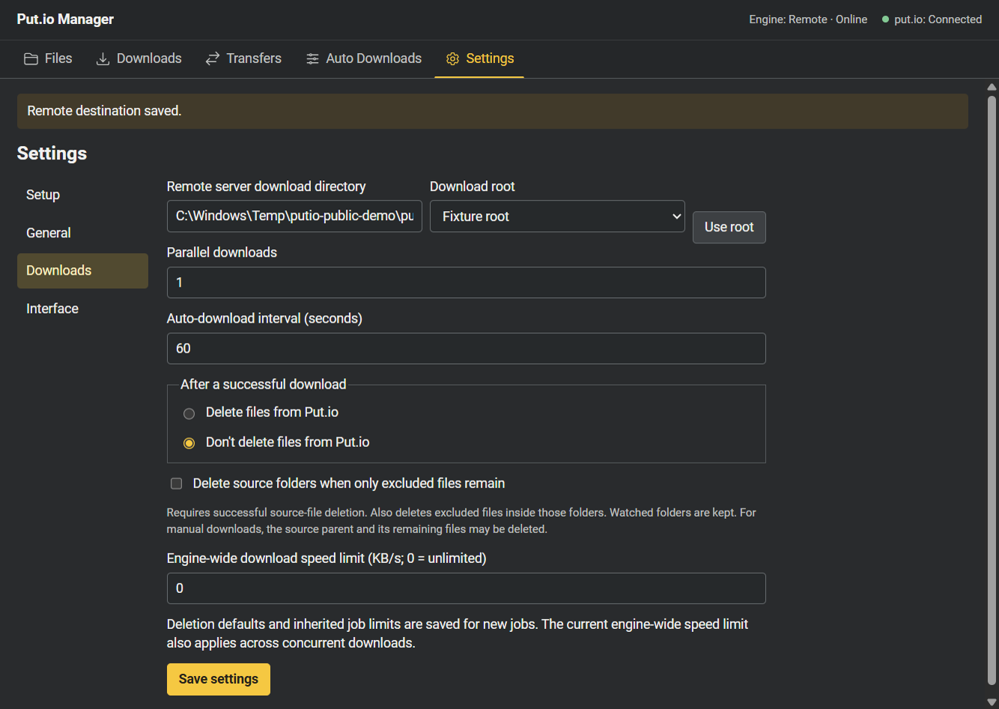
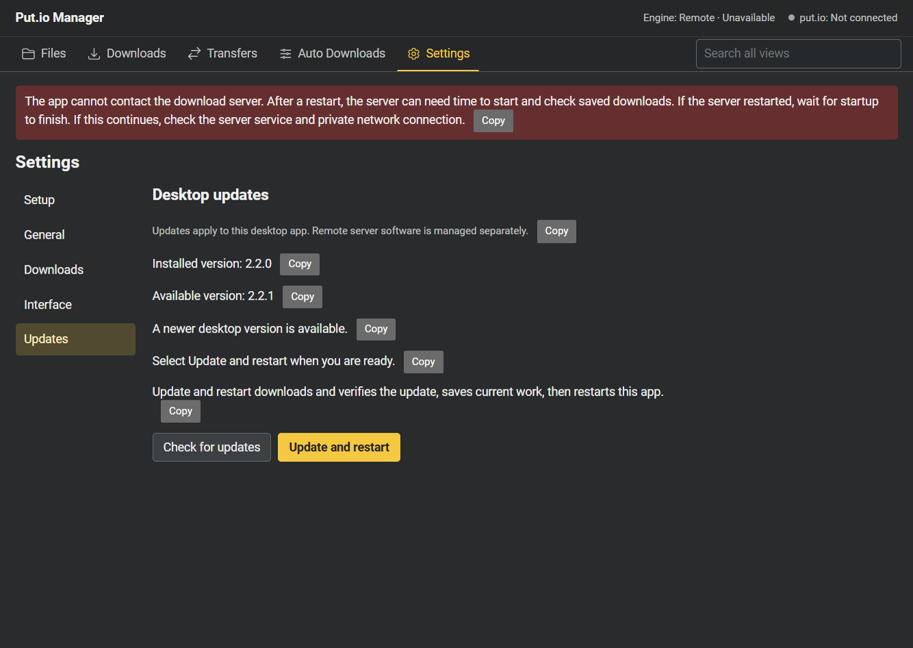

# Putio Manager

Browse your put.io account, copy files to your computer or a Linux download server, and automate repeated downloads from selected folders.

The desktop app runs on Windows, macOS and Linux. A separate headless engine can keep downloading on a server after you quit the desktop app. You can download to the destination directly or use an optional staging area on the engine host before copying to the destination. Source cleanup requires verified delivery and the job's saved cleanup choices.

**Start here:** [Download](#download) · [Screenshot guide](#screenshot-guide) · [Desktop setup](#desktop-setup) · [Desktop updates](#desktop-update) · [Linux remote server](#linux-remote-server) · [CLI and safe analytics](#cli-and-safe-analytics) · [Everyday use](#everyday-use) · [Staging](#optional-staging-before-delivery) · [Jellyfin](#connect-a-jellyfin-library) · [Troubleshooting](#troubleshooting)

## Download

Choose your operating system and processor. Use an installed Windows app, a macOS app bundle or a Linux AppImage for desktop updates from **Settings → Updates**.

| Desktop edition | Most Intel / AMD computers | ARM computers |
| --- | --- | --- |
| Windows installer | [x64 EXE](https://github.com/garbledhamster/putio-manager/releases/download/v2.2.0/PutioManager-2.2.0-windows-x64-setup.exe) · [x64 MSI](https://github.com/garbledhamster/putio-manager/releases/download/v2.2.0/PutioManager-2.2.0-windows-x64-setup.msi) | [ARM64 EXE](https://github.com/garbledhamster/putio-manager/releases/download/v2.2.0/PutioManager-2.2.0-windows-arm64-setup.exe) · [ARM64 MSI](https://github.com/garbledhamster/putio-manager/releases/download/v2.2.0/PutioManager-2.2.0-windows-arm64-setup.msi) |
| macOS app bundle | [Intel Mac app ZIP](https://github.com/garbledhamster/putio-manager/releases/download/v2.2.0/PutioManager-2.2.0-macos-x64-update.zip) | [Apple silicon app ZIP](https://github.com/garbledhamster/putio-manager/releases/download/v2.2.0/PutioManager-2.2.0-macos-arm64-update.zip) |
| Linux desktop | [x64 AppImage](https://github.com/garbledhamster/putio-manager/releases/download/v2.2.0/PutioManager-2.2.0-linux-x64.AppImage) | [ARM64 AppImage](https://github.com/garbledhamster/putio-manager/releases/download/v2.2.0/PutioManager-2.2.0-linux-arm64.AppImage) |

For a **headless Linux server**, choose the matching portable archive below. Each portable archive contains the desktop app, the headless engine, a matching Node runtime and a launcher. You do not need a separate Node installation. Windows installers, macOS app ZIPs and Linux AppImages contain the desktop edition; use the portable archive for the headless tools.

| Portable distribution | Most Intel / AMD computers | ARM computers |
| --- | --- | --- |
| Windows | [Windows x64 ZIP](https://github.com/garbledhamster/putio-manager/releases/download/v2.2.0/PutioManager-2.2.0-windows-x64.zip) | [Windows ARM64 ZIP](https://github.com/garbledhamster/putio-manager/releases/download/v2.2.0/PutioManager-2.2.0-windows-arm64.zip) |
| macOS | [Intel Mac archive](https://github.com/garbledhamster/putio-manager/releases/download/v2.2.0/PutioManager-2.2.0-macos-x64.tar.gz) | [Apple silicon archive](https://github.com/garbledhamster/putio-manager/releases/download/v2.2.0/PutioManager-2.2.0-macos-arm64.tar.gz) |
| Linux | [Linux x64 archive](https://github.com/garbledhamster/putio-manager/releases/download/v2.2.0/PutioManager-2.2.0-linux-x64.tar.gz) | [Linux ARM64 archive](https://github.com/garbledhamster/putio-manager/releases/download/v2.2.0/PutioManager-2.2.0-linux-arm64.tar.gz) |

[Release notes and all files](https://github.com/garbledhamster/putio-manager/releases/tag/v2.2.0) · [SHA-256 checksums](https://github.com/garbledhamster/putio-manager/releases/download/v2.2.0/SHA256SUMS.txt)

These links target the versioned v2.2.0 release. If a file is not available, keep your current installation and wait for that release. Read the release's CI results for its native build and installation checks.

The release does not include Windows publisher code signing or macOS Developer ID signing and notarization. The operating system can block the app or installer. Follow your organization's policy and the operating system's normal permission process. Do not disable security software. Signed update metadata and download hashes check the published update bytes; they do not replace the operating system's publisher identity checks.

To find your processor: Windows **Settings → System → About → System type**; macOS **Apple menu → About This Mac**; Linux `uname -m` (`x86_64` means x64, `aarch64` means ARM64). Linux desktop mode also needs the usual Electron desktop libraries and a graphical session. Linux server mode does not need Electron or a display.

<details>
<summary>Verify a downloaded file</summary>

Download `SHA256SUMS.txt` from the same release. In PowerShell:

```powershell
Get-FileHash .\PutioManager-2.2.0-windows-x64.zip -Algorithm SHA256
```

On macOS:

```sh
shasum -a 256 PutioManager-2.2.0-macos-arm64.tar.gz
```

On Linux, with the checksums and archive in the same directory:

```sh
sha256sum --check --ignore-missing SHA256SUMS.txt
```

Compare the entire hash for the exact filename. For an EXE, MSI, app ZIP or AppImage, use that file in the same hash command. A mismatch means you should obtain a fresh copy before opening it. Checksums detect a mismatched file; they are not a code-signing identity.

</details>

## Screenshot guide

Every image below comes from the real app running against a newly generated, isolated demonstration service. Folder names, files, transfers, credentials and destinations are synthetic. Visible temporary paths belong to the disposable demonstration; choose your own download and staging directories. No live account, household server or media library appears in these images. Screenshot 8 uses a disposable Windows demonstration server; on Linux, the same control shows your server's Linux download path, such as `/srv/putio-downloads`. Click an image to enlarge it; use the numbered links to follow the full instructions.

<table>
  <tr>
    <td width="50%"><a href="docs/images/01-setup.png"></a><br><b>1. Choose where downloads run.</b> <a href="#desktop-setup">Desktop setup</a></td>
    <td width="50%"><a href="docs/images/02-connect-account.png"></a><br><b>2. Connect put.io.</b> <a href="#link-your-account-and-choose-a-destination">Account and destination</a></td>
  </tr>
  <tr>
    <td><a href="docs/images/03-download-settings.png"></a><br><b>3. Keep sources for your first copy.</b> <a href="#make-your-first-download">First download</a></td>
    <td><a href="docs/images/04-browse-files.png"></a><br><b>4. Browse and select a file.</b> <a href="#browse-and-manage-putio-files">Files</a></td>
  </tr>
  <tr>
    <td><a href="docs/images/05-automatic-rule.png"></a><br><b>5. Automate a selected folder.</b> <a href="#automatic-download-rules">Rules and schedules</a></td>
    <td><a href="docs/images/06-download-progress.png"></a><br><b>6. Check completed and canceled jobs.</b> <a href="#understand-download-status">Status and recovery</a></td>
  </tr>
  <tr>
    <td><a href="docs/images/07-remote-connection.png"></a><br><b>7. Connect to your Linux engine.</b> <a href="#connect-the-desktop-through-ssh">SSH and Remote setup</a></td>
    <td><a href="docs/images/08-remote-download-root.png"></a><br><b>8. Select the server destination.</b> <a href="#connect-the-desktop-through-ssh">Remote download root</a></td>
  </tr>
  <tr>
    <td colspan="2"><a href="docs/images/09-software-updates.png"></a><br><b>9. Update the desktop app, even with Remote offline.</b> <a href="#desktop-update">Desktop update steps</a>. The available version in this image is a generated test release.</td>
  </tr>
</table>

## Understand Local and Remote

| Operation | What happens |
| --- | --- |
| **Transfer** | put.io fetches a source into your put.io account. |
| **Download, Local engine** | This computer copies a file from put.io to the local destination you choose. |
| **Download, Remote engine** | Your server copies a file from put.io to an allowed server destination. The file stays on that server. |
| **Automatic-download rule** | The selected engine periodically checks a put.io folder and queues matching files. |
| **Optional staging** | The selected engine downloads into its own staging area, copies to the destination and verifies that copy before publishing it. Remote staging uses the server's storage. |
| **Optional cleanup** | The selected engine deletes an eligible put.io source after verified destination publication, subject to the job's saved options. |

The **Engine** and **put.io** indicators show separate connections. A reachable Remote engine can still need account authorization. Selecting Remote does not copy existing local jobs or account settings to the server. A connection failure does not silently switch downloads back to Local.

Download destinations, staging, limits, rules and account authorization belong to the selected engine. Check the indicator before saving changes. The settings form preserves fields you are editing while fresh status arrives and saves the fields you changed. Switching engines loads that engine's settings. Desktop startup, magnet registration and saved table layouts belong to the desktop client.

## Desktop setup

### Windows

1. Download the **EXE** for your processor. Choose the **MSI** instead if you need to run Windows Installer directly. Verify the file against the checksum from the same release.
2. Sign in as the Windows user who will use the app. Run the installer as that user and follow its prompts. The app installs for that user in `%LOCALAPPDATA%\Programs\PutioManager` and adds a Start menu shortcut. Do not run the installer as a different administrator account.
3. Open **Putio Manager** from the Start menu. Continue with [account and destination](#link-your-account-and-choose-a-destination).
4. Keep a copy of the installer if you will need repair. Use Windows **Settings → Apps → Installed apps → Putio Manager** to remove the installed application. The uninstaller keeps the app profile and downloaded files.

The EXE contains the same MSI that you can download separately. Both install one application owned by Windows Installer. To upgrade, run a newer EXE or MSI for the **same processor architecture and Windows user**. You can switch between EXE and MSI for an upgrade; you do not need to remove the app first. Do not install both architectures over the same installation. A change of architecture needs a separate migration plan.

If you prefer a portable copy, extract the entire Windows ZIP to a permanent folder. Open its `PutioManager-win32-x64-distribution` folder, or the ARM64 equivalent, and double-click `launch.cmd`. Keep its distribution files together. To move from a portable copy to the installed edition, quit the portable app from its tray first, run the installer as the same Windows user, and open the Start menu app. Check your saved settings before deleting the old program folder. Do not copy your private profile into the application folder.

### macOS

1. Download the app ZIP for your Mac's processor and verify its checksum. Extract `PutioManager.app`.
2. Move the app into an Applications folder that your user can manage. Open it from there. Keep it out of a temporary extraction directory.
3. If macOS blocks the app, use the policy-approved process in [Apple's guidance for opening apps safely](https://support.apple.com/en-us/102445). Do not disable Gatekeeper or remove security attributes as a setup step.
4. Continue with [account and destination](#link-your-account-and-choose-a-destination).

The Mac app includes Sparkle for in-app updates. Its update ZIP contains only `PutioManager.app`; it does not replace a headless server, a sibling Node runtime or other files from a portable distribution. If you choose the full portable archive, keep its files together and open `desktop/PutioManager.app`, or use `./launch --mode gui`. A headless Linux engine remains a separate installation.

### Linux desktop

1. Download the AppImage for your processor and verify its checksum. Put it in a permanent folder that your ordinary user can write to. Automatic replacement needs write access to that folder and space for the new app.
2. In a terminal in that folder, make it executable and start it. For x64:

   ```sh
   chmod u+x PutioManager-2.2.0-linux-x64.AppImage
   ./PutioManager-2.2.0-linux-x64.AppImage
   ```

3. Install your distribution's supported AppImage and Electron desktop prerequisites if the app reports a missing runtime component. Run in a graphical session as your ordinary user. Do not use root or `--no-sandbox` to work around a launch error.
4. Continue with [account and destination](#link-your-account-and-choose-a-destination).

Use the AppImage itself for desktop updates. The updater checks the new file, prepares it beside the existing AppImage on the same filesystem, and replaces the app in one rename before restarting it. It keeps the existing filename, so use **Installed version** in Settings to check the running version. An extracted portable Linux desktop cannot replace itself this way; install the AppImage or use the [manual portable procedure](#manual-portable-desktop-replacement).

For a server without a display, use the Linux portable archive and [Linux remote server](#linux-remote-server). An AppImage is not the headless service package.

### Link your account and choose a destination

1. Open **Settings → General** and choose **Local** for downloads on this computer. For a prepared server, use [Remote connection steps](#connect-the-desktop-through-ssh) instead.
2. Click **Connect with put.io**. Sign in to put.io in the browser and approve the connection. Return to the app and wait for the put.io indicator to show **Connected**.
3. Account authorization belongs to the selected engine. Reconnect with the same control if authorization expires. The app uses operating-system secure storage when available; if the screen says the connection lasts only until the engine stops, reconnect after restarting or configure a supported secure-storage backend.
4. Open **Settings → Downloads**. In Local mode click **Browse**, choose an existing destination, and click **Save settings**. In Remote mode select an allowed **Download root** and click **Use root**.
5. For the first download, select **Don't delete files from Put.io**. Leave **Delete source folders when only excluded files remain** and **Use temporary storage before copying to the download folder** unchecked. Save settings. You can configure [staging](#optional-staging-before-delivery) after the first direct download works.
6. **Settings → Setup** links back to the account and destination controls whenever you need to revisit them.

The optional manual-token disclosure is an advanced alternative to browser linking. Enter only a token you obtained for your own account. Never paste a token into an issue, screenshot, command argument or shared log.

### Make your first download

1. Use a small file you own or have permission to download. Keep source deletion off while proving your setup.
2. Open **Files**, click **Refresh**, expand a folder and select the file. Click **Download**.
3. Review the download dialog's source-deletion, folder-cleanup and speed options. Choose **Don't delete files from Put.io** and **Keep source folders** if overriding defaults. Read the **Effective** summary, then submit.
4. Open **Downloads**. Wait for **completed**, then read any warning beside it. **Downloaded - not verified** and **Needs attention** require inspection; neither proves a verified copy. A zero-byte queue entry, an active progress bar or a transfer finishing at put.io does not establish a completed local copy.
5. Confirm the copy is accessible at the chosen destination on the selected engine host. If using Jellyfin, also complete the [library check](#connect-a-jellyfin-library).
6. Refresh **Files** and confirm the put.io source is still present. Once the complete path works, decide whether [optional source cleanup](#optional-source-cleanup) fits your workflow.

## Linux remote server

This example uses a new Debian/Ubuntu-style systemd service, a dedicated `putio` service user, `/srv/putio-downloads` for downloads and `/var/lib/putio-manager/private` for private configuration. These names and `downloads.example.net` are fictional examples. Replace the SSH hostname and operator account with your own. Use a new installation directory; these commands do not migrate an existing engine.

The server needs outbound HTTPS to put.io, sufficient disk space, a supported Linux CPU/runtime, systemd for the service example, and an already configured SSH server reachable by your desktop. The desktop can run Windows, macOS or Linux. The headless engine uses the bundled Node runtime and does not need Electron, a desktop session or an npm install.

### 1. Install the server distribution

Download the matching **Linux** archive and `SHA256SUMS.txt` from the release. Verify its hash, then extract the archive on the server. For x64:

```sh
tar -xzf PutioManager-2.2.0-linux-x64.tar.gz
sudo install -d -m 0755 /opt/putio-manager
sudo mv PutioManager-linux-x64-distribution /opt/putio-manager/2.2.0
sudo chown -R root:root /opt/putio-manager/2.2.0
```

For ARM64 use the ARM64 archive and extracted folder name. `/opt/putio-manager/2.2.0` must be unused before this move. Keeping program files root-owned prevents the download service from rewriting its executable.

Create the service identity and writable data locations once:

```sh
sudo useradd --system --user-group --home-dir /var/lib/putio-manager --create-home --shell /usr/sbin/nologin putio
sudo install -d -o putio -g putio -m 0750 /var/lib/putio-manager /srv/putio-downloads
```

If the account already exists, inspect it and reuse it only if it is the intended dedicated service identity. If downloads belong on an external disk, mount that disk persistently first and use its real mounted destination. Verify the mount and permissions before starting the engine; an ordinary empty mountpoint is not proof the disk is attached. Do not recursively change ownership of an existing media library as a shortcut.

### 2. Create a new private configuration

Run this in an **interactive server terminal**:

```sh
sudo -u putio /opt/putio-manager/2.2.0/launch --mode headless setup --config /var/lib/putio-manager/private/config.json
```

At the prompts enter:

```text
Existing absolute download directory: /srv/putio-downloads
Loopback port [5173]: 5173
```

The root directory must already exist. The parent `private` directory must **not** exist: setup creates it privately and refuses to overwrite an existing installation. Do not create `private` with an earlier `mkdir` step and do not rerun setup over a working configuration.

Setup creates `config.json`, a `client-token`, a separate `credential-key` and a state path. The client token authorizes desktop control of this server; the encryption key protects saved put.io authorization. Both are secrets. POSIX key files must remain owned by the service identity and inaccessible to other users. The configuration binds to **127.0.0.1**, not a public interface.

### 3. Install the unprivileged systemd service

Create `/etc/systemd/system/putio-manager.service` with your editor:

```ini
[Unit]
Description=Putio Manager download engine
Wants=network-online.target
After=network-online.target
RequiresMountsFor=/srv/putio-downloads /var/lib/putio-manager

[Service]
Type=simple
User=putio
Group=putio
WorkingDirectory=/opt/putio-manager/2.2.0
ExecStart=/opt/putio-manager/2.2.0/node /opt/putio-manager/2.2.0/headless/server/cli.js serve --config /var/lib/putio-manager/private/config.json
Restart=on-failure
RestartSec=5
TimeoutStopSec=60
UMask=0077
NoNewPrivileges=true
PrivateTmp=true
ProtectHome=true
ProtectSystem=strict
ReadWritePaths=/var/lib/putio-manager /srv/putio-downloads

[Install]
WantedBy=multi-user.target
```

If you choose different roots, update the configuration, `RequiresMountsFor` and `ReadWritePaths` together. This example limits the service's writable locations to its own data and download roots. It does not replace Linux ownership, disk-mount checks, a firewall or SSH authentication. The service directives are documented in [systemd.service](https://www.freedesktop.org/software/systemd/man/latest/systemd.service.html) and [systemd.exec](https://www.freedesktop.org/software/systemd/man/latest/systemd.exec.html).

Start and inspect the service:

```sh
sudo systemctl daemon-reload
sudo systemctl enable --now putio-manager.service
sudo systemctl status putio-manager.service --no-pager
sudo journalctl -u putio-manager.service -n 30 --no-pager
```

Look for **Server ready** in the service log. Check its authenticated status locally:

```sh
sudo -u putio /opt/putio-manager/2.2.0/launch --mode headless status --config /var/lib/putio-manager/private/config.json
```

Status uses the safe operational format described under [CLI and safe analytics](#cli-and-safe-analytics). It excludes filenames, paths and credentials. Counts and byte totals still describe private activity. An active systemd process alone does not prove the account is connected or a download finished.

### 4. Authorize put.io on the server

With the service running, use another interactive server terminal:

```sh
sudo -u putio /opt/putio-manager/2.2.0/launch --mode headless auth --config /var/lib/putio-manager/private/config.json
```

Open the displayed **put.io** authorization link in your browser and approve the connection. That link is temporary and private; do not capture it in documentation or logs. Then check status again. You can also connect the desktop to the Remote engine and use **Connect with put.io** there; the account is still saved on the server.

### Connect the desktop through SSH

1. Use your ordinary SSH operator account, separate from the `putio` service user. Verify the server's SSH host key through a trusted channel on first connection. Do not turn off host-key checking.
2. In **PowerShell on Windows** or **Terminal on macOS/Linux**, start this tunnel and leave its window open:

   ```sh
   ssh -N -T -o ExitOnForwardFailure=yes -o ServerAliveInterval=30 -o ServerAliveCountMax=3 -L 127.0.0.1:15173:127.0.0.1:5173 operator@downloads.example.net
   ```

   Replace only the example account/hostname and any deliberately changed ports. The first `127.0.0.1:15173` is your desktop listener; the final `127.0.0.1:5173` is the server's loopback engine. No router port-forward or public engine listener is needed. Windows needs the [OpenSSH Client](https://learn.microsoft.com/en-us/windows-server/administration/openssh/openssh_install_firstuse), not an SSH server on the desktop. A successful `-N` tunnel normally stays quiet.
3. In a private server terminal, retrieve the **client** credential once:

   ```sh
   sudo -u putio cat /var/lib/putio-manager/private/client-token
   ```

   This command deliberately displays a secret. Use your own trusted terminal; never record, screenshot or paste its output into chat/issues. Copy it directly into the app's masked client-credential field. Do not copy `credential-key`, which is not a desktop connection token. Clear your clipboard after pasting and close the private terminal when finished.
4. In the desktop app open **Settings → General → Remote connection details**. Enter server address **`http://127.0.0.1:15173`**, an optional friendly name such as **My download server**, and that client credential. Click **Save remote connection**.
5. Choose **Engine → Remote**. Wait for **Remote · Online** and the put.io connected indicator. If you have not linked put.io, click **Connect with put.io** and approve it in the browser.
6. Open **Settings → Downloads**, choose **Download root → Downloads**, and click **Use root**. Read the **Remote server download directory** path: it belongs to the server, not the desktop. Keep source deletion off and save settings for the first copy.
7. Run [the first-download check](#make-your-first-download). Close the desktop only after you understand that the **server service continues its queued and scheduled work**. Closing the SSH tunnel disconnects the desktop; it does not stop the server's engine.

Keep both desktop and server on compatible **Remote protocol version 2** software. An older engine is rejected before commands are sent. If port `15173` is already used on the desktop, choose another unused local port and change the desktop server address to match. The server port remains `5173` unless you changed its configuration.

For routine stopping, use **Downloads → Pause** first. Wait for active transfers/copies to become paused and for any publication or cleanup already in progress to settle. Read any reported error. To stop the service completely:

```sh
sudo systemctl stop putio-manager.service
```

To resume the service, use `sudo systemctl start putio-manager.service`, then resume queued work in the app if it is paused. The CLI also supports `pause` and `resume` in place of `status` with the same config argument. Pause survives an engine restart.

### Optional staging on the Linux server

The basic server configuration downloads straight to its allowed destination. To use staging, provision a separate private directory on the **server's local storage**, then enable the option through the Remote desktop connection. The words **Download locally** in Settings refer to the selected engine host, which is the server in Remote mode.

For a new staging area in the example layout:

```sh
sudo install -d -o putio -g putio -m 0700 /var/lib/putio-manager/staging
```

Pause the engine, wait for it to settle, and stop the service before editing its existing private `config.json`. Preserve its current roots and credential-file paths. Add this top-level JSON property, with a comma where the surrounding JSON requires one:

```json
"stagingDirectory": "/var/lib/putio-manager/staging"
```

The example service already permits writes beneath `/var/lib/putio-manager`. If you use a different staging volume, mount it persistently and add its path to both `RequiresMountsFor` and `ReadWritePaths` in the service. Keep the staging directory outside the Jellyfin library and protect it with permissions for the service identity. Restart the service, reconnect the desktop, and follow [the staging controls](#optional-staging-before-delivery). The Remote staging path is read-only in the desktop app; its value comes from the server configuration.

For an existing staging setup, retain its state and staged files before changing the path. A server staging-path change disables staging for new downloads and displays a notice; saved staged jobs may need attention. Review the path and existing jobs before enabling staging again. Do not move or delete retained partial files to force recovery.

## Everyday use

### Browse and manage put.io files

**Files** shows your account's folder tree. Click **Refresh** to reload it, expand folders and select an item before choosing an action. **New folder**, **Rename** and **Delete** change your put.io account. Use the displayed confirmation and verify the selected item; manual Delete is separate from after-download cleanup.

Use **Search all views** to filter the current view. In Files, a search also discovers matching items in nested folders. Clear the search to return to the normal tree.

To move a file or folder **within put.io**:

1. Right-click its row, or use the row's actions control, and choose **Manage → Move…**.
2. In **Move to folder**, expand the destination tree, select a folder and choose **Move here**. **Put.io root** is a valid destination when the item is not already there.
3. You can also drag an item onto an eligible visible folder. You cannot move the account root, move an item into its current folder or itself, or move a folder into its own descendants.
4. Check the move notice and refreshed listing. If the notice says the item moved but the listing could not refresh, use **Refresh** before taking another action. If Remote move controls are unavailable, update the server to a version that supports file moves.

A put.io move changes the cloud folder location. It does not relocate an existing download on your computer or server. Review any automatic rules that watch the affected folders.

**Download** copies a selected file to the executing engine's download destination. **ZIP** downloads the selected file or folder as a ZIP archive. ZIP preparation can take time at put.io; a ZIP response reporting missing files is rejected. The manager saves the ZIP; it does not extract and organize it into a media library.

The **Open folder** action opens a Local destination on this computer. A Remote server directory cannot be opened as though it were a desktop path; use your own authorized server access or library application to view it.

### Understand download status

**Downloads** lists jobs and progress. Select a job for **Cancel** or, when offered, **Retry**. Right-click a file or download row, or open its row actions, for the corresponding actions menu. A **Copy** control beside a status or error copies the displayed message; inspect it for private filenames and paths before sharing it.

| Control or result | Meaning and next action |
| --- | --- |
| **Pause / paused / Copy paused** | Stops new scans and starts, suspends active download/copy work and preserves owned partials. An operation already publishing a destination or deleting a source can cross its safe completion boundary before Pause returns. Read any pause error. |
| **Resume** | Allows scans and queued work again and resumes eligible paused jobs. The engine checks saved evidence before continuing a partial; it may recover or restart the transfer. |
| **Cancel / Cancel all** | Requests cancellation of the selected or outstanding jobs and removes owned partials when safe. It does not request successful-download source cleanup. A publication or provider deletion already in progress may finish; inspect the result. |
| **Waiting · Retry at…** | A temporary failure has a scheduled retry. Keep the engine running and resumed, or inspect the cause and use Retry when offered. |
| **Recovering / Restarting** | The engine checks the source and saved partial, obtains a fresh URL, or starts over when safe continuation is unavailable. Progress may restart. |
| **Copying / Verifying destination** | A staged job has reached the destination-copy and verification steps. Wait for the final result before treating it as delivered. |
| **Retry** | Explicitly queues an eligible failed, canceled, interrupted, waiting or needs-attention job. Resolve its reported cause first; Retry does not bypass ownership or verification checks. |
| **completed** | The engine published the destination with verified download evidence. Read cleanup and staging warnings separately, and verify the file in your consuming app. |
| **Downloaded - not verified** | The engine saved bytes but lacks the evidence needed for verified completion, such as a known source length. It retains the put.io source. Inspect the result; do not treat this label as permission to delete the source. |
| **Needs attention** | A storage, source-change, ownership, verification or recovery guard stopped automatic work on this job. Read the message, resolve the cause and use Retry only when offered. Preserve retained state and partials. |
| **interrupted** | Saved work could not resume automatically. Inspect its error and destination, then use Retry when appropriate. |
| **Downloaded locally; remote cleanup failed / outcome unknown** | Keep the good downloaded copy. Refresh put.io and inspect the specific source before deciding what cleanup to perform. Do not assume deletion succeeded or blindly repeat it. |

Existing destination files are protected from silent overwrite. Changing defaults affects new jobs; already queued jobs retain their saved per-job options. Download URLs are refreshed when needed rather than stored as permanent credentials.

Eligible temporary connection/server failures retry with a delay. Authentication failures, a changed source, unsafe paths, exhausted storage and uncertain file ownership can require your attention instead. If a message says **Source changed; retry to accept the refreshed source**, inspect that change before Retry; accepting it can discard the old partial and begin with the current source. Some unsafe or unresolved-close states keep Retry unavailable until the engine can recover safely.

### Sort and arrange tables

In **Downloads**, click a column heading to sort and click it again to reverse direction. Undated rows stay after dated rows when sorting a date column.

In **Downloads**, **Transfers** and **Auto Downloads**, drag a heading to reorder columns and drag its edge to resize it. With keyboard focus on a heading, use Left/Right to move it; focus its resize handle and use Left/Right to adjust its width. **Reset columns** restores that table's default order and widths. The desktop client saves column order and widths for later use; each table has its own layout.

### Transfers into put.io

1. In **Files**, select the put.io destination folder.
2. Open **Transfers** and choose **Add transfer**.
3. Paste a supported source link you are authorized to use, review its destination, and submit.
4. Refresh **Transfers** to follow put.io's progress. Cancel a selected transfer when needed.

A finished transfer means the source reached put.io. Use a manual download or an automatic rule to copy it from put.io to your computer/server. Incoming magnet-link handling can be registered in **Settings → Interface** where supported; incoming links use your currently selected engine. Registration is optional.

### Automatic-download rules

1. Set the correct engine and download root first. In **Files**, select a put.io **folder** and click **Auto download**. You can also open **Auto Downloads** and add a rule for the selected folder.
2. Review the destination prefilled from the folder name. The rule destination is created within the selected engine's allowed root. Use a contained subfolder such as `Demo downloads`; avoid pointing several unrelated rules at the same destination.
3. Enter comma-separated extensions, for example `pdf, txt`, or leave blank for all file extensions. Matching is case-insensitive. **Minimum size (MB)** is the lower size threshold; use `0` to include small files. The calculation uses 1,048,576 bytes per displayed MB.
4. Choose **Keep folder structure** if nested source folders should remain nested in the destination.
5. Choose a schedule: **Use global interval**, the rule's own **Interval**, **Daily**, or **Weekly**. Daily/weekly time uses the **engine time zone shown in the dialog**, which may differ from your desktop in Remote mode. Missed scheduled runs are skipped rather than accumulated.
6. Review deletion, source-folder cleanup and speed overrides and the **Effective** summary. Keep source deletion off for a new rule until you have verified its matches and destination. Save the rule.
7. Use **Check now** in **Auto Downloads** to run a rule check when the engine is connected and resumed. Check **Downloads** for actual work. Rule-list presence alone does not prove a successful download.
8. Select a rule to **Edit** or **Remove** it. Removing a rule stops future scans for that rule; check existing queued jobs separately. Inspect the displayed next run after editing a schedule.

The engine avoids duplicate active work for the same source/destination. Keep history and state with the engine rather than deleting them to try to force a re-download.

### Speed, parallelism and per-job choices

**Settings → Downloads** controls the maximum concurrent downloads, global automatic-download interval, default source handling and **Engine-wide download speed limit (KB/s; 0 = unlimited)**.

Rules and file/ZIP download dialogs can **Use global** or override the source-file and folder-cleanup choices. A blank job/rule speed limit inherits the global default; `0` is an explicit unlimited job limit. The engine-wide aggregate speed limit still caps concurrent traffic. Review the **Effective** summary to see the actual inherited choices before queuing.

Default deletion and inherited job limits are captured when a job is queued. Later changes to those defaults do not rewrite existing jobs. The current engine-wide aggregate cap also applies to active traffic.

### Optional staging before delivery

Staging is **off by default**. It adds a step between downloading and publishing the final destination:

```text
put.io → private staging area on the engine host → destination copy → verification → published file
```

Use it when you want the network download to land on engine-local storage before the engine copies it to another destination. It needs room for retained staged bytes and the destination copy. It does not copy Remote downloads onto your desktop.

1. Choose an existing, private **engine-local** staging directory outside your media library. Use a local filesystem with the file and hard-link operations the app requires; Windows UNC shares are rejected for staging. Keep other users and applications out of this working area. On Windows, protect the chosen directory with its filesystem ACL; downloaded staging bytes are not an encrypted archive.
2. In **Settings → Downloads**, review **Temporary folder on the download host**. In Local mode use its **Browse** control. In Remote mode an administrator must [configure the server path](#optional-staging-on-the-linux-server); the desktop cannot replace that path.
3. Set **Staging budget (GiB)** and **Free-space reserve (GiB)**. Defaults are **20 GiB** for retained staging data and **10 GiB** of free-space reserve. The budget must be positive; the reserve can be zero. Leave enough real space on both staging and destination volumes. The engine checks reservations and can stop with a capacity message rather than overfill the available space.
4. Check **Use temporary storage before copying to the download folder** and click **Save settings**. “Locally” means the selected engine host. Confirm the selected Local/Remote indicator and path before queuing a job.
5. Start a new small download with source deletion off. Follow **Downloads** through network transfer, **Copying**, **Verifying destination** and its final status. Check the destination file before enabling cleanup.

New jobs save their staging choice, directory and limits. Turning staging on or off does not convert existing queued jobs. A tighter current budget or higher reserve also constrains saved staged jobs; relaxing a setting does not remove a stricter limit already saved for a job. Paused, failed or needs-attention jobs can retain staged bytes and consume the budget. Keep their state and partials while investigating. Do not delete the hidden engine namespace or its anchor files as a space-recovery shortcut.

The engine verifies the destination copy against the staged bytes before publication and releases its retained staging artifacts after safe completion. A separate staging-cleanup warning can remain beside a good delivered copy. Unknown source evidence still produces **Downloaded - not verified** and keeps the put.io source, even when the destination matches the staged bytes.

### Optional source cleanup

Enable cleanup only after a successful copy has reached the right destination and, when relevant, your library can read it.

1. In **Settings → Downloads**, choose **Delete files from Put.io** to make successful source-file cleanup the default, or set deletion for an individual rule/download instead. Click **Save settings**.
2. For a specific rule or manual file/ZIP download, choose **Use global**, **Delete**, or **Keep**. Read the effective summary. Keep overrides deletion for that job.
3. A source is eligible for deletion only after verified destination publication and the required source checks. **Downloaded - not verified**, source changes and unresolved recovery guards retain the source. ZIP cleanup also requires verified source-content eligibility. A completed download with a cleanup error remains a completed local copy with a separate warning.
4. Refresh **Files** to confirm the intended source disappeared. Verify the destination remains usable. If provider cleanup failed or is uncertain, inspect before taking a separate action.

**Source-folder cleanup is a different, broader option.** **Delete source folders when only excluded files remain** is off by default. After successful source-file deletion, it can delete the source folder **and excluded leftovers inside it**, such as files rejected by a rule's extension/size filters. Watched folders are kept; explicit Keep choices, pending/failed work and uncertain state can defer cleanup. For manual downloads the source parent and remaining files may be affected. Turn it on only when you intend that broader scope; a rule or job can explicitly keep source folders.

For a ZIP, source cleanup applies to the **selected put.io source**, not merely a temporary ZIP download URL. Put.io listing and deletion are separate operations, so concurrent changes by other clients can affect what is present at cleanup time. Avoid organizing the same source folder elsewhere during its cleanup.

### Interface and startup

**Settings → Interface** controls tooltips, supported desktop login startup and optional magnet registration. Save changed settings. Desktop login startup is supported through native Windows/macOS controls; Linux desktop login startup is explicitly unsupported. Linux headless reboot startup comes from the systemd service, not this desktop checkbox. Tray behavior depends on the desktop environment.

When the system tray is available, minimizing or closing the window hides it while the desktop process keeps running. Use the tray's **Show** action or double-click its icon to restore the window. Choose **Quit** in the tray when you intend to exit the desktop process. Closing the window is not the same as quitting.

Local downloads and scans belong to that desktop process. Pause first if you want them held, then Quit. Remote work belongs to the server service and continues after you hide or quit the desktop client. Use Pause/Cancel on the selected engine or stop the server service when you intend to stop Remote work.

## Connect a Jellyfin library

Putio Manager saves files; Jellyfin indexes a directory you configure. It does not receive a file directly from the desktop client. Use the same underlying directory on the engine host and the Jellyfin host/container mapping.

For example, an operator might use:

| Layer | Fictional example |
| --- | --- |
| Manager server download root | `/srv/putio-downloads` |
| Rule destination under that root | `Movies` |
| Resulting host directory | `/srv/putio-downloads/Movies` |
| Docker bind, if Jellyfin is containerized | `/srv/putio-downloads/Movies:/media/Movies:ro` |
| Jellyfin library folder inside that container | `/media/Movies` |

Use your existing Jellyfin deployment's supported volume/library controls; adapt paths without replacing unrelated libraries. The Manager service needs write permission on its destination. Jellyfin needs read/traverse permission through its normal account/group or ACL; avoid world-writable permissions or recursive ownership changes to an existing library.

1. Keep source deletion disabled for the first library test.
2. Configure a rule or destination on the correct engine host that maps to the intended Jellyfin library. If using a file/ZIP manual download, remember it uses the engine's current destination, and ZIPs are not automatically extracted.
3. Download a small media item you are authorized to use and wait for successful completion in **Downloads**.
4. In Jellyfin's dashboard, confirm the library points to the corresponding host/container path and run its supported library scan.
5. Confirm the new item appears and can be read/played in Jellyfin. A scan starting, a Manager Completed status or a library folder name alone does not prove this end-to-end result.
6. Only then enable the cleanup policy you want. For the next completed item, check both Jellyfin availability and the specific source's disappearance from put.io.

For deployment-specific library details, consult [Jellyfin's library documentation](https://jellyfin.org/docs/general/server/libraries/). If Manager and Jellyfin run on different machines, arrange your own authenticated storage share/mount; setting a desktop-looking path in the app does not transfer the download to another host automatically.

## Update, back up and recover

### Desktop update

Use **Settings → Updates** on an updating desktop edition. This page works even when the Remote server is offline. It shows the installed desktop version, the available version, the operation's progress and the next action.

1. Open **Settings → Updates** and select **Check for updates**.
2. Read the available version and status. The app checks the fixed `garbledhamster/putio-manager` GitHub repository for a newer stable release. It ignores drafts, prereleases and older versions. It accepts versioned release files only after it verifies the update metadata and required download checks.
3. Save changes in other apps. If you want downloads to remain paused after the restart, pause the selected engine before continuing. Select **Update and restart** when you are ready for this desktop app to close and reopen.
4. Wait for download and verification. Use **Cancel download** if you change your mind. Cancellation is available before the app starts saving its work for installation. During preparation and installation, wait for the result instead of closing the app or starting another installer.
5. The app closes its Local engine through its normal save and recovery checks before it installs. If it cannot close safely, it stops the update and shows the next action. In Remote mode it disconnects this client; the server keeps its own lifecycle.
6. After the app restarts, open **Settings → Updates**. Confirm **Installed version** matches the version you chose. Check the selected engine, saved account connection, destinations, rules, history and any recovery warnings. Resume work only when intended. A downloaded file or a full progress bar does not prove installation.

The updater preserves the existing app profile and downloaded files. It does not change your selected engine or turn a Remote connection failure into a Local engine. It does not update or restart a Remote server. Keep the server on a compatible protocol version through the separate [Linux server upgrade](#linux-server-backup-and-upgrade) procedure.

On Windows, the updater uses the same per-user MSI ownership as the EXE and MSI downloads. On macOS, Sparkle verifies and replaces the app bundle. On Linux, the updater verifies and replaces the AppImage. A failure before replacement leaves the current app in place. After an installation error, read the status and verify the installed version before trying again. If Windows reports a computer restart is required, save your work and restart Windows when you are ready; the updater does not force a reboot.

If the app says the update signature or download could not be verified, do not install that file by hand. Keep the installed app and check for updates again later. If automatic updates are unavailable for your copy, use the matching desktop edition from [Download](#download).

### Desktop update commands

Use the desktop executable's `--app-update` option for these software operations. This interface does not read account settings or download jobs, contact the Remote engine, or start a Local engine. It reports only the desktop update fields and controlled messages. You can use it without a configured Remote connection. It is separate from `--agent` and the headless server commands.

For the installed Windows app, run in PowerShell:

```powershell
& "$env:LOCALAPPDATA\Programs\PutioManager\PutioManager.exe" --app-update status
& "$env:LOCALAPPDATA\Programs\PutioManager\PutioManager.exe" --app-update check
& "$env:LOCALAPPDATA\Programs\PutioManager\PutioManager.exe" --app-update install
& "$env:LOCALAPPDATA\Programs\PutioManager\PutioManager.exe" --app-update cancel
```

For a Mac app in `/Applications`, use Terminal:

```sh
/Applications/PutioManager.app/Contents/MacOS/PutioManager --app-update status
/Applications/PutioManager.app/Contents/MacOS/PutioManager --app-update check
/Applications/PutioManager.app/Contents/MacOS/PutioManager --app-update install
/Applications/PutioManager.app/Contents/MacOS/PutioManager --app-update cancel
```

For an AppImage, run from its folder. Replace the filename if yours differs:

```sh
./PutioManager-2.2.0-linux-x64.AppImage --app-update status
./PutioManager-2.2.0-linux-x64.AppImage --app-update check
./PutioManager-2.2.0-linux-x64.AppImage --app-update install
./PutioManager-2.2.0-linux-x64.AppImage --app-update cancel
```

Run one command at a time. `status` reads the current update state; `check` requests a fresh release check. `install` authorizes the desktop restart after verification. When a desktop process is already running, it handles the request; an `accepted` response confirms the request, not a finished installation. `cancel` requests cancellation before preparation. Check `status` for the result. The installed version after restart is the completion check.

### Manual portable desktop replacement

1. Pause work if needed and use **Quit** from the desktop tray. Closing its window can leave the app running. A Remote server keeps running on its own host.
2. Download and verify the new portable archive. Extract it to a new version folder. Keep the old folder until you check the replacement.
3. Start the new app or launcher as the same operating-system user. Update your shortcut to the new program folder. Check the selected engine, account connection, destination, rules and history before resuming.
4. Keep your profile, state and downloaded files outside release archives and public support reports. Do not merge the new program files into the old bundle or copy private configuration into them.

### Linux server backup and upgrade

1. Pause work, wait for the pause operation to settle and stop `putio-manager.service`. Confirm it is stopped. Do not run two engines against the same state directory.
2. Back up the **whole private configuration directory and state together**, including `client-token` and `credential-key`, to protected storage. The encryption key is required to use encrypted saved authorization. Back up your downloaded files separately if you need them; the application state backup is not a media backup.
3. For the example layout, this creates a private local archive without printing secrets:

   ```sh
   sudo install -d -m 0700 /var/backups/putio-manager
   sudo sh -c 'umask 077; tar -czf /var/backups/putio-manager/private-backup.tgz -C /var/lib putio-manager'
   ```

   Choose a new backup filename if one already exists. Keep it private and verify you can read its archive listing locally. Never attach it to GitHub. If staging lives beneath `/var/lib/putio-manager` as in this guide, this archive also includes retained staged bytes and can be large. Preserve any external staging area with the matching recovery state; do not remove partials during an upgrade.
4. Extract the verified new distribution into a new root-owned version directory. Update the service's `WorkingDirectory` and both executable paths in `ExecStart`. Keep the config/state paths unchanged; **do not rerun setup** over an existing configuration.
5. Run `sudo systemctl daemon-reload`, start the service, and check its status locally. Reopen the tunnel and desktop; verify the selected Remote engine, account, destination and existing history before resuming.
6. If rollback is necessary, stop the new service first. Preserve its state, restore the matching earlier program/service paths and a compatible protected state backup if needed, then verify before resuming. Never let old and new engines share the same state concurrently.

### After interruption or an error

After restart, the engine can requeue eligible saved downloads and obtain fresh source URLs. It preserves paused and canceled intent. Jobs whose source, destination, staging evidence or ownership need inspection can remain **interrupted** or **Needs attention**. Read the message before choosing Retry. If the source changed, Retry accepts the refreshed source only after your explicit choice. An uncertain cloud cleanup is not replayed automatically.

Only one process can own an engine state directory. If startup reports an ownership/recovery problem, confirm no engine/service is still using it. Do not delete ownership locks or recovery guards automatically. Keep a protected backup and obtain help with a minimal sanitized error description.

## Troubleshooting

| Symptom | Check and next action |
| --- | --- |
| **Remote unavailable / reconnecting** | Confirm the server service is ready, the SSH tunnel is still open, the desktop URL uses the tunnel's local port, and client/server protocol versions match. Restore the connection; do not switch to Local unless you intend downloads on this computer. |
| **Remote authentication rejected** | Use the server's `client-token`, not its encryption key or put.io token. Save it in Remote connection details. Keep the value out of support reports. |
| **put.io not connected** | Link the account on the selected engine. Browser authorization does not transfer a Local connection to Remote automatically. |
| **Setup failed** | Use an absolute config path whose parent is new, an existing absolute download root, a valid free port and the intended service user's permissions. Do not delete working state just to rerun setup. |
| **No remote download roots** | Check the server config's allowed roots and service filesystem permissions. Restart the service after a deliberate config edit, then select **Use root**. |
| **No rule matches / nothing starts** | Check engine/account status, pause state, selected source folder, extension/minimum-size filters, schedule/time zone and destination. Use **Check now** in Auto Downloads when resumed and inspect job errors. |
| **Destination unavailable / permission error** | Check the actual engine host, mounted disk, free space and dedicated identity's write/traverse rights. For systemd, check `ReadWritePaths` too. Do not broadly relax permissions. |
| **Staging cannot be enabled** | Choose an existing private engine-local directory. Remote mode also needs `stagingDirectory` in the server config. Check the service's writable paths and any staging-path-change notice. |
| **Staging capacity / free-space reserve error** | Check free space on both volumes, retained staged jobs, the saved job limits and current budget/reserve. Resolve the cause before Retry; do not delete hidden partial or anchor files. |
| **Completed but still on put.io** | Inspect the job's saved Keep/Delete choice and any cleanup warning. Changing a default later does not change that already queued job. |
| **Downloaded - not verified** | The engine lacks enough source evidence for verified completion and retains the source. Inspect the downloaded result and source; a full progress bar does not resolve missing evidence. |
| **Needs attention / source changed** | Read the job message, resolve storage/source/ownership concerns and use Retry only when available. A source-change Retry can replace the old partial. Keep state and retained files until recovery is understood. |
| **Completed but absent from Jellyfin** | Check the real host/container mapping, library type, Jellyfin read permissions and library scan. The Manager may have saved a ZIP, which it does not extract. |
| **Interrupted after restart** | Eligible work can requeue automatically; for a job still interrupted, check its message and destination, then choose **Retry** when appropriate. Do not remove history or state to force recovery. |
| **Move unavailable in Remote mode** | Update the remote engine to a version advertising file-move support. Do not switch to Local just to make the control available. |
| **Window disappeared after Close** | Check the system tray. Use **Show** to reopen it and **Quit** to exit the desktop process. |
| **Linux desktop sandbox/runtime error** | Use your distribution's supported Electron prerequisites and sandbox configuration as an ordinary user; do not launch the GUI as root or add `--no-sandbox`. Headless mode uses the bundled Node runtime. |
| **Desktop update cannot contact GitHub** | Check the desktop internet connection, then select **Check for updates** again. A Remote server connection is not required. |
| **Update signature or download verification failed** | Keep the installed app. Do not bypass verification or install the rejected file by hand. Check for updates again later. |
| **Windows Installer busy / update cancelled** | Finish the other installation or wait until you are ready. Reopen the app, check **Installed version**, then retry. |
| **Desktop update unavailable** | Use the installed Windows app, macOS app bundle with Sparkle, or a writable Linux AppImage. Update a headless Linux server through its own service procedure. |
| **Unsigned app blocked** | Review the source/release provenance and your operating-system/organization policy. Do not disable protections as a workaround. |

For help, open an [issue](https://github.com/garbledhamster/putio-manager/issues) with the app version, OS/architecture, Local or Remote mode, exact sanitized error and the steps to reproduce with generated examples. Remove account identifiers, tokens, authorization links, real filenames, private paths, hostnames/IPs and logs containing them. A tiny fictional example is more useful than a full private configuration or state archive.

## Development and license

The application uses TypeScript and Electron with plain core services and a narrow desktop bridge. The renderer has no Node access. Remote mode uses authenticated commands and state subscriptions; browser-origin API requests are rejected. The server normally listens on loopback behind your authenticated tunnel. Local credentials use supported OS secure storage; headless credentials use an independently protected key.

Use the Node version specified by the project's build configuration, then:

```sh
npm ci
npm run verify
npm run package
npm run test:package
npm run package:distribution
```

`verify` checks type/build, disposable service/integration fixtures and the actual Electron renderer scenario. `test:package` runs the same isolated scenario through the native package. Package each platform/architecture on its matching native runner. These tests use generated data and do not need a real put.io account. Screenshot generation uses the same synthetic fixture with `--smoke-test --evidence-dir=ABSOLUTE_OUTPUT_DIRECTORY`; use a generic isolated temporary root so private usernames never enter screenshots.

Putio Manager is licensed under **GPL-3.0-only**; see [LICENSE](LICENSE). It builds on the original put.io Download Manager by **Gunhan Ozden**. Bundled Heroicons use the MIT license; their notices and asset provenance are retained. Distributions include the applicable application, Electron/Chromium and Node notices. This is an independent application, not an official put.io or Jellyfin product.

## CLI and safe analytics

Agents use the CLI for all administration. The desktop GUI remains available for people. CLI status output contains an explicit allowlist of operational fields. It excludes filenames, folder paths, account and process identifiers, usernames, process command names, server labels and addresses, credentials, authorization links, raw error messages and exact event timestamps. The CLI does not open media contents or browse the put.io file tree.

Anonymous job and root references come from opaque internal IDs. They remain useful for selecting an operation without disclosing a name. Counts, byte totals and progress are still operational metadata; keep exported reports private unless you choose to share them.

### Use the desktop's saved Remote connection

After a person has configured a Remote connection, open a terminal in the extracted distribution folder. On Windows:

```powershell
.\launch.cmd --mode agent help
.\launch.cmd --mode agent status
.\launch.cmd --mode agent analytics
.\launch.cmd --mode agent downloads
.\launch.cmd --mode agent storage
.\launch.cmd --mode agent settings
```

On macOS use `./launch --mode agent` followed by the same command. This mode uses the existing operating-system protected Remote credential internally. It creates no window, makes no new Local engine, and never falls back to Local when Remote is unavailable. It refuses a saved Local profile. It needs the existing SSH tunnel or private connection to remain available. Agents do not extract credentials to call the server directly.

On Linux, a server without a display should use the headless CLI below. Desktop agent mode uses the installed desktop runtime and operating-system secure storage; it is not a replacement for headless service mode.

### Use the headless CLI on the Linux server

In the fictional server layout used above, run commands as the dedicated service identity:

```sh
sudo -u putio /opt/putio-manager/2.2.0/launch --mode headless agent help
sudo -u putio /opt/putio-manager/2.2.0/launch --mode headless agent status --config /var/lib/putio-manager/private/config.json
sudo -u putio /opt/putio-manager/2.2.0/launch --mode headless agent analytics --config /var/lib/putio-manager/private/config.json
sudo -u putio /opt/putio-manager/2.2.0/launch --mode headless agent storage --config /var/lib/putio-manager/private/config.json
```

Use your own installed version directory. `PUTIO_MANAGER_CONFIG` can supply the private config path instead of `--config`. The application reads its client credential internally. No token command argument is accepted. Normal `status`, `pause` and `resume` also use the safe status format. The explicit `agent` interface rejects human-only `setup`, `serve` and `auth` commands. Human account linking remains a separate interactive action.

Commands return one JSON object and an exit code. Zero means the requested command succeeded; a nonzero code includes a controlled error category and a next action. Do not treat an unavailable storage measurement as zero free bytes: it returns `null` with an unavailable status.

| Command | Safe result or action |
| --- | --- |
| `status` | Selected host, pause/account state and aggregate counts. |
| `analytics` | Counts by job state, delivery step, cleanup state and error category; aggregate bytes and current transfer speed. |
| `downloads` | Anonymous job references, progress, verification/cleanup state and controlled next actions. |
| `storage` | Anonymous volume references and capacity/free-space measurements from filesystem metadata only. |
| `settings` | Safe numeric/boolean download settings; no paths or credentials. |
| `roots` | Anonymous references for configured download roots. |
| `retry job_REF` | Retry one current eligible job through the existing engine guards. |
| `cleanup job_REF` | Request guarded temporary-copy cleanup for a published job with a staging warning. |
| `cancel job_REF` | Request cancellation of one job; the engine decides which owned temporary files it can safely remove. |
| `pause` / `resume` | Pause or resume the selected server's jobs and scans. |
| `check-rules` | Request a rule check on the selected server. |
| `root-select root_REF` | Select one allowed download root by its current anonymous reference. |
| `settings-set --json` | Apply only supported numeric/boolean settings supplied through stdin. |

Copy a complete `job_…` or `root_…` reference from the current output; `job_REF` and `root_REF` above are placeholders. Retry eligibility is not a promise of success. The engine still validates recovery state, source changes, file identity and destination verification. Cleanup does not remove the completed destination or manually delete a put.io source. Unknown or unsafe ownership remains blocked. A successful command response includes the updated safe job status; read it before claiming recovery completed.

Historical speed values do not contribute to current throughput. `deliveryVerified` requires a completed job, recorded verification and no job error. `recordedVerification` preserves the engine's earlier evidence separately; it does not make a job needing attention a verified delivery.

For direct downloads on the server, turn temporary staging off for **new jobs** through stdin:

```sh
printf '%s\n' '{"stageDownloads":false}' | sudo -u putio /opt/putio-manager/2.2.0/launch --mode headless agent settings-set --json --config /var/lib/putio-manager/private/config.json
```

This does not change an existing job's saved staging choice or move work onto the desktop. Root selection and all downloads still belong to the server. Path, token and unknown setting fields are rejected by this safe interface. Keep server folder provisioning in the authorized server setup procedure.

### Restart only the manager service

Run service lifecycle commands on the Linux service host using its existing operating-system permissions:

```sh
/opt/putio-manager/2.2.0/launch --mode headless service help
/opt/putio-manager/2.2.0/launch --mode headless service status
sudo /opt/putio-manager/2.2.0/launch --mode headless service restart
```

These commands control only `putio-manager.service`. They do not accept another unit, run a shell, request a password dialog or reboot the machine. A user service may use the trailing `--user` option. An administrator may supply the necessary permission through the existing system policy; the CLI does not grant it.

On Linux, `service status` can also report elapsed process time, CPU time and cumulative storage bytes read from kernel process metadata. It obtains the fixed service's process identifier internally and reads only its kernel metadata files and system uptime. It does not return that identifier, the process command, usernames or paths. `bytesRead` is process I/O accumulated over the process's lifetime, not download traffic or current transfer speed. Missing permissions or unusable measurements produce an unavailable process state and `null` counters.

These measurements can help observe a process while the application's connection is unavailable. They do not identify what a job is doing or prove successful recovery. `applicationReady` remains `null` and `readiness` remains `not-verified`; an active service or changing CPU/I/O counters do not verify application readiness. After a restart, allow time for saved-download checks before retrying the application status command.

Before an update or planned interruption, use the manager's `pause` command and read its result. After a restart, verify `service status`, then `agent status`, `storage` and `downloads`. Resume only when intended. An active service does not prove account connection, job completion or resumed work. Saved paused/canceled intent and the existing recovery guards remain in force.

### Clear error explanations

End-user error messages use short sentences, consistent terms and explicit next actions informed by ASD-STE100. They replace internal terms such as ownership anchors and publication with a description of the affected download step. This is not a certification claim. The message separates an unverified destination, a temporary-file cleanup problem and an uncertain put.io deletion. It does not invent a cause for an older generic error or claim a copy is safe without verification evidence.

## Maintainer releases

Give each release a new stable three-part version in `package.json` and `package-lock.json`. Check the source, generated illustrations and new commit identities for private data before pushing. Keep the release's signing key private and keep its matching public verification key in the application.

A push to `main` starts the six native builds. After all build, installation, update and payload checks pass, the publication workflow validates that exact build, signs its update metadata and Mac archives with the repository's `PUTIO_UPDATE_SIGNING_KEY` secret, verifies the uploaded files, and publishes the GitHub release. An existing version or tag is kept; publish a newer version for later changes. Do not replace files in a published release.

Desktop clients find that newer stable release through **Settings → Updates** or the update CLI. Headless Linux servers have a separate [backup and upgrade procedure](#linux-server-backup-and-upgrade).


